<div align="center">

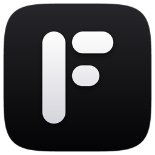

# Fleet

Run several Roblox accounts at once on Windows.

[Download](../../releases/latest)

</div>

<p align="center">
  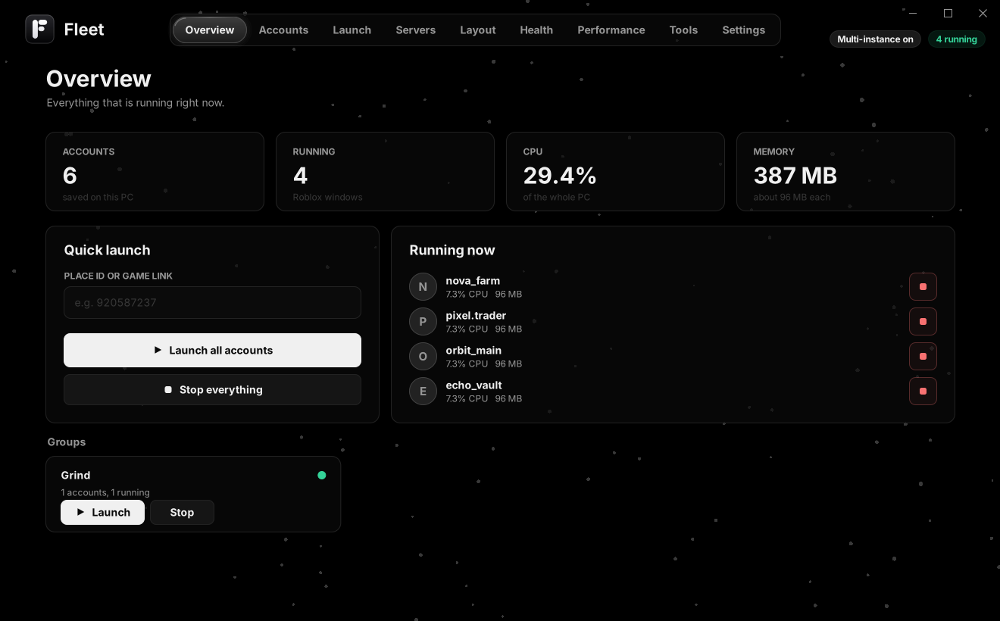
  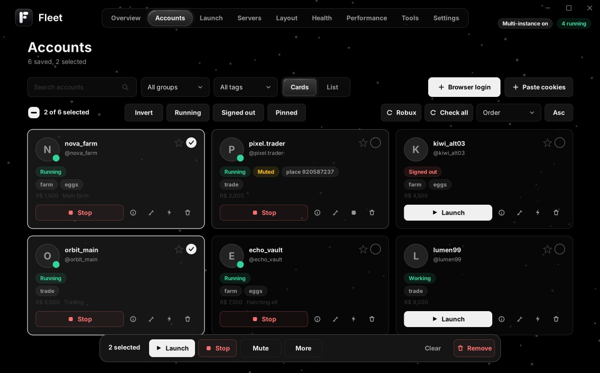
</p>

Fleet keeps your Roblox accounts in one place and starts as many of them as you like. It puts the windows in a tidy grid, keeps each one from eating your PC, and starts an account again if its window closes. It is one exe with no installer.

The look is black and plain on purpose.

## Install

1. Download `Fleet.exe` from the latest release and run it. `SHA256SUMS.txt` next to it has the hash if you want to check the file.
2. The exe is not code signed, so Windows SmartScreen may warn you the first time. Choose More info, then Run anyway.
3. The first start asks a few things: language, a look, whether to turn on multi-instance, how heavy Roblox may be, where to keep your data (normal or portable), and whether to add Fleet to the Start menu.

Portable mode keeps everything in a `FleetData` folder next to the exe. Because that folder can be copied, portable mode always asks you for a password, and your accounts file is encrypted with it.

## Using it

Add accounts with Browser login (Fleet opens Edge or Chrome, you sign in, and it reads the login) or by pasting cookies. Select some accounts on their cards, open Launch, pick a game, and press Launch. Layout tiles the windows.

Close all Roblox windows before turning on multi-instance. If Roblox is already open when Fleet starts, it asks whether to close it first.

<p align="center">
  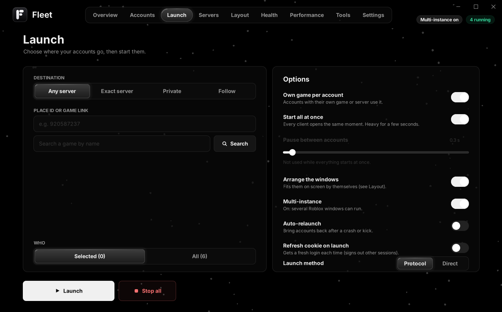
  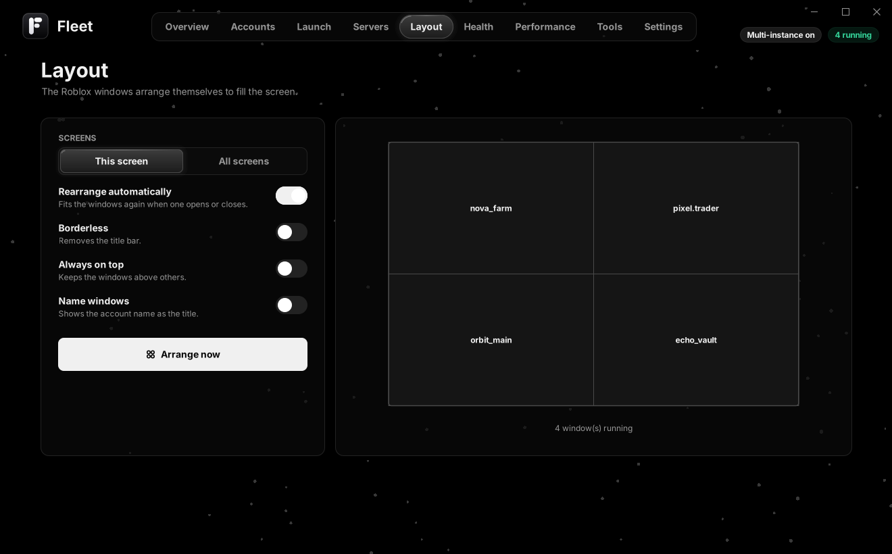
</p>

## What is in it

Accounts
- Cards or a list, search, groups, tags, colours, notes, aliases and saved passwords.
- Click, Ctrl and Shift click, or drag a box to select. Star accounts, sort them, drag them into order, and undo or redo changes.
- Login checks, Robux, a browser login, and import from other managers.

Launching
- Any server, a specific one, a private server, or join a friend.
- Saved private servers, presets that restore accounts, game and layout, and a scheduler.
- Auto relaunch with a crash breaker, so an account that keeps crashing is paused instead of looping.
- Each account can use its own Roblox version or its own proxy.

Windows and performance
- A grid that fits the screen, across one or all screens, which redraws itself when a window opens or closes.
- Frame rate limit, graphics level, process priority, and CPU and memory limits per window.
- Windows in the background can be slowed down, and memory can be trimmed by hand or on a timer.
- History charts of CPU and memory for each window, with a warning when one climbs.

<p align="center">
  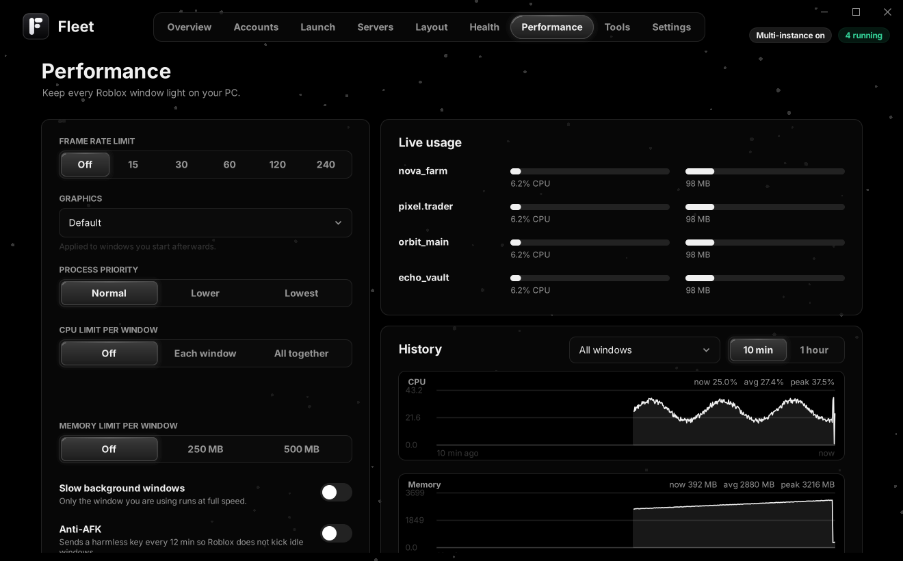
  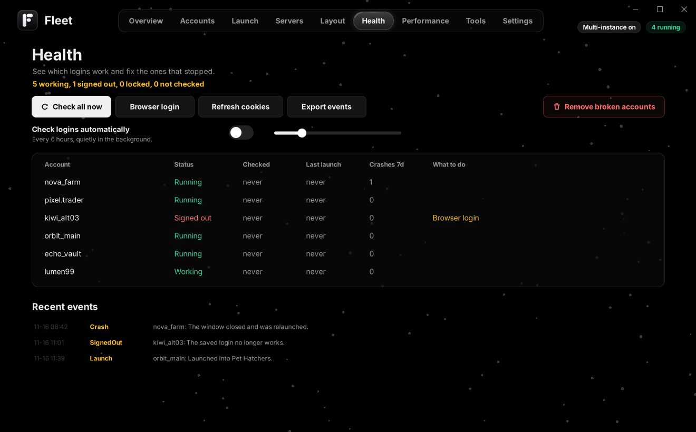
</p>

The Roblox optimizer
- Recolours Roblox's menus, icons and effects to one colour or to your Fleet theme, and can draw a new sky.
- Can change the cursor, the font, the loading screen, a few sounds (silence them, or use your own oof) and some textures.
- Everything is off until you turn it on and press Apply. Restore puts every changed file back.
- It only edits picture and sound files. Colours that Roblox draws from code, like the hotbar, cannot be changed, and a Roblox update brings the originals back until you apply again.

<p align="center">
  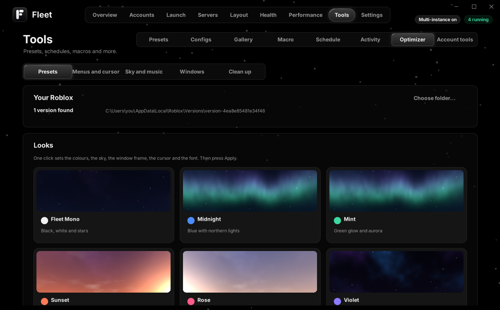
  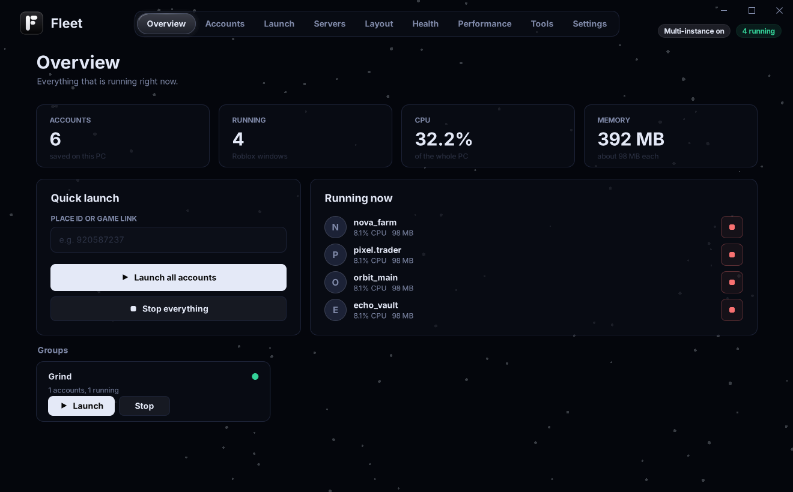
</p>

Lyrics and overlays
- Lyrics for the song Spotify is playing, drawn over Roblox only. They can be a single line, or short phrases with different sized words, and they follow the beat if you ask them to.
- Optional overlays over the Roblox window in front: a clock, how long you have played, CPU and memory, the song, the account, a note and a crosshair.
- Ctrl+Shift+F opens a small menu inside Roblox for changing these while you play. The key can be changed.

<p align="center">
  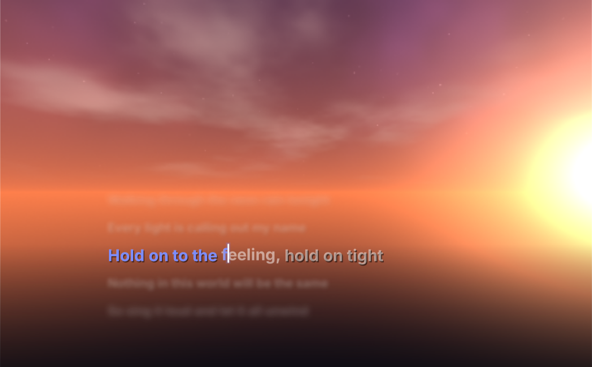
  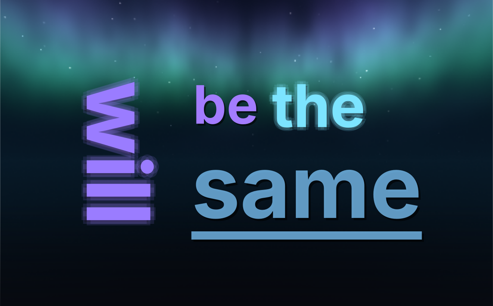
</p>
<p align="center">
  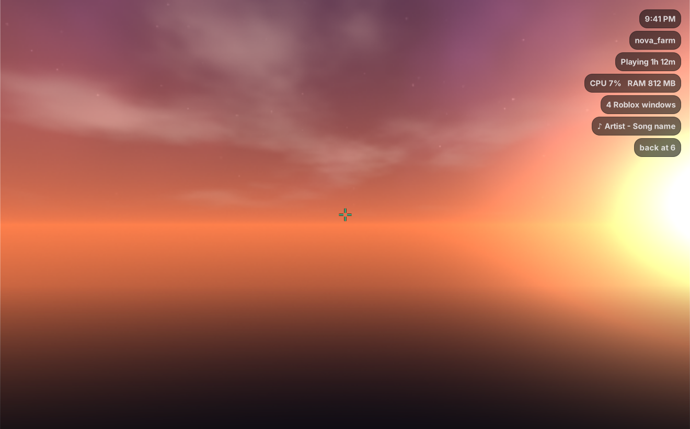
  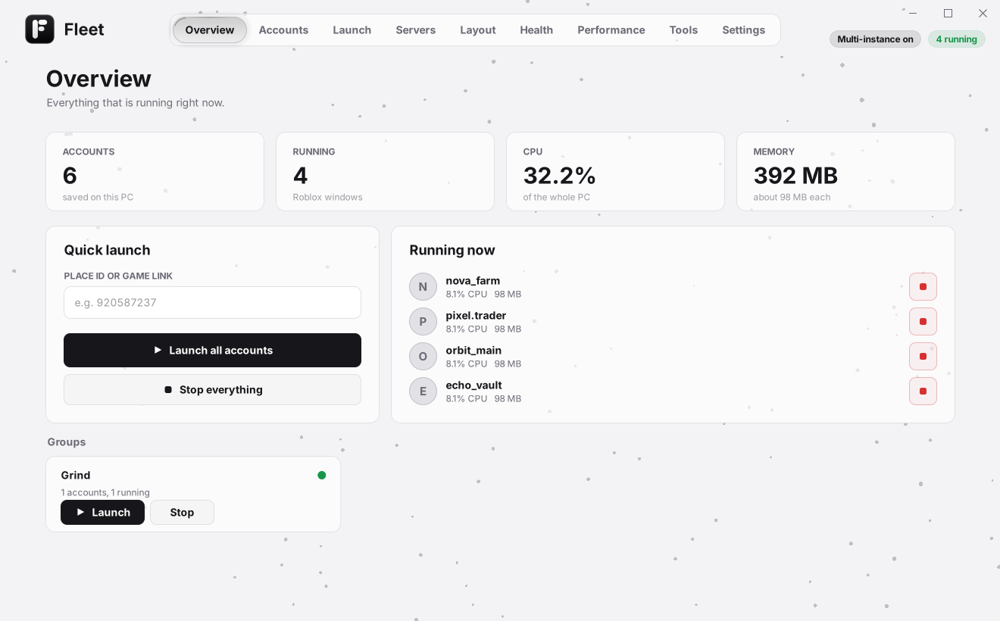
</p>

Other
- Eight black themes and four light ones, your own colour schemes, and ten languages.
- Alerts for crashes, kicks, low Robux and high memory, to Discord or Windows notifications.
- A macro recorder, a mini window, a tray icon, global hotkeys, and Discord Rich Presence.
- Accounts are encrypted with Windows, or with your own password. Backups and restore are built in.
- A command line, below.

<p align="center">
  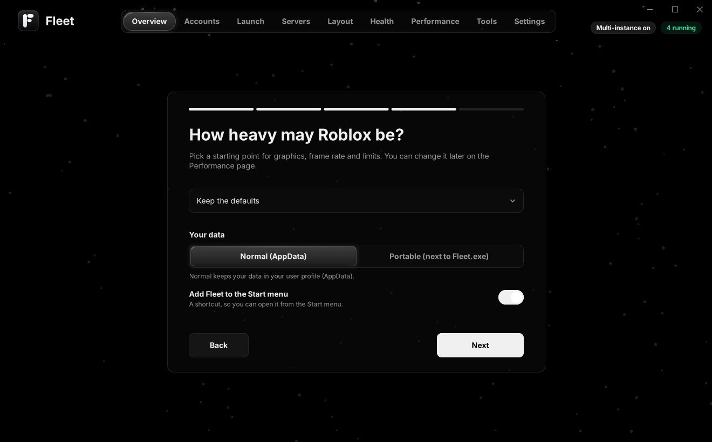
  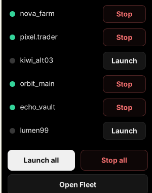
</p>

<sub>The screenshots use made-up accounts. The lyrics and overlay pictures are drawn over a generated sky, not a real game.</sub>

## Command line

Run `Fleet.exe <command>` from a terminal. It sends the command to the running Fleet (and starts Fleet minimized if it is not running), prints the answer and returns an exit code, so scripts can use it. A terminal does not wait for a windowed program, so in scripts use `start /wait Fleet.exe <command>`. The examples below write `fleetctl`, which is just `Fleet.exe` under a shorter name. Add `--json` to any listing for machine readable output. Exit codes: 0 fine, 1 the command failed, 2 timed out, 4 could not reach Fleet.

```
fleetctl help                      every command
fleetctl help account              the commands of one group
fleetctl launch nova_farm --place 920587237 --wait
fleetctl launch --group Farm --private "https://www.roblox.com/games/920587237/x?privateServerLinkCode=abc"
fleetctl stop --all
fleetctl account list --json
fleetctl config set FpsCap 30
```

| Group | What it covers |
|---|---|
| `launch`, `stop`, `restart`, `running` | start accounts by name, group, tag or all, into a place, a server, a private server or a friend; close them |
| `account ...` | list, info, add (cookie, file, stdin or another manager's export), remove, set fields, tags, mute, check logins, Robux, details, refresh cookie, sort, rename, import, export |
| `server ...`, `preset ...` | saved private servers (add, assign, check, public list) and presets (save, run, delete) |
| `layout ...` | arrange now, screens and Roblox's smallest size |
| `health ...` | login checks, the crash and kick journal, csv export |
| `config ...`, `theme ...`, `perf ...`, `multi` | every setting by its name (`config list`), themes, frame rate, graphics, priority, one click configs, memory trimming |
| `optimizer ...`, `roblox ...` | the Roblox optimizer, the Roblox folder, downloading, deleting and choosing versions |
| `schedule ...`, `macro ...`, `proxy ...`, `webhook test` | scheduled actions, the macro recorder, proxies, the Discord webhook |
| `backup ...`, `gallery ...`, `update ...`, `data path` | backups, shared configs and themes, updates |
| `status`, `log`, `show`, `hide`, `mini`, `quit`, `version` | the app itself |

The older `Fleet.exe --launch NAME --place ID`, `--launch-preset`, `--launch-all`, `--stop-all` and `fleet://` links still work.

## Safety and privacy

- Accounts are encrypted and stay on your PC, in `%AppData%\Fleet` or in the `FleetData` folder in portable mode.
- Fleet talks to Roblox, to Spotify if you connect it, to a few lyrics sites, and to GitHub to check for updates. Cookies only go to roblox.com.
- Nothing is injected into Roblox. Multi-instance works by holding Roblox's single-instance lock.
- Roblox can change its client at any time, and running several clients may be against its rules. Use Fleet with your own accounts and at your own risk.

Fleet is an independent project and is not affiliated with or endorsed by Roblox. All rights reserved, see [LICENSE](LICENSE).
